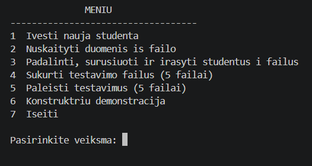
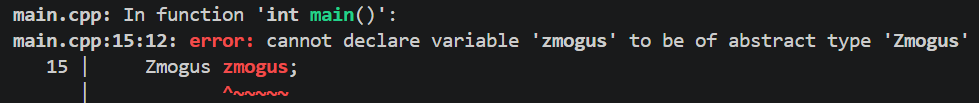
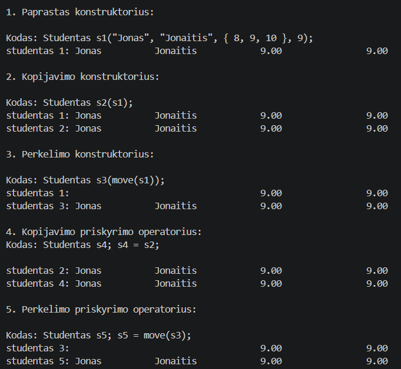
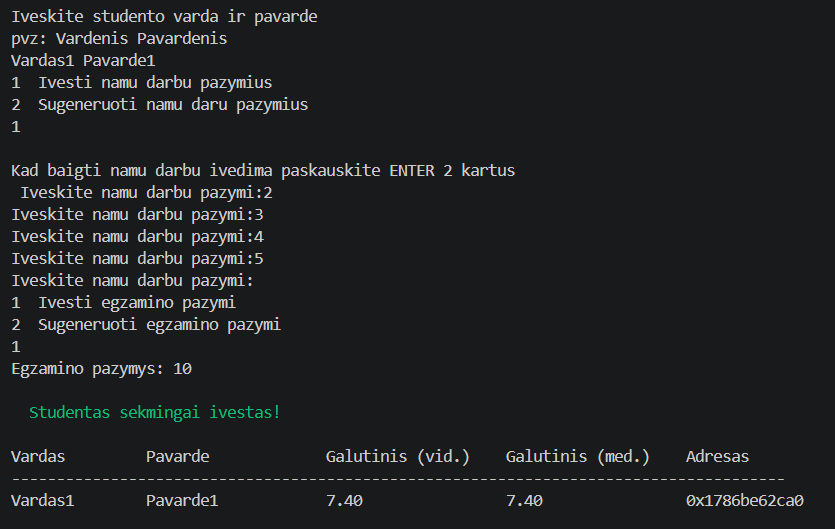
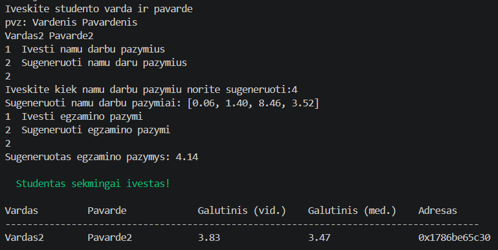
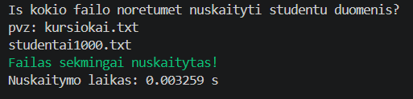
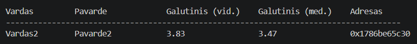
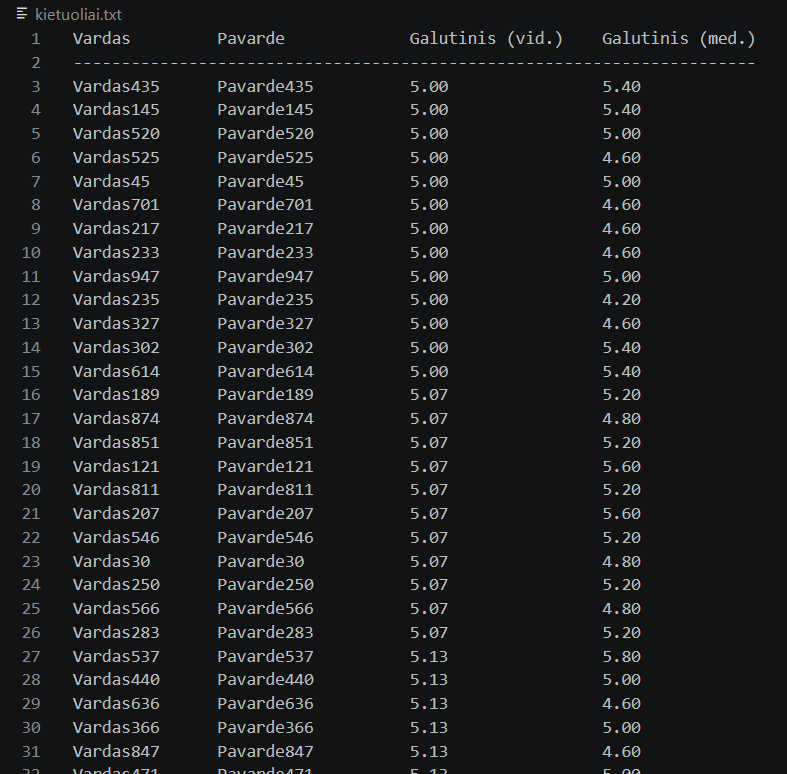
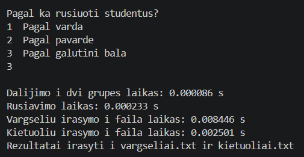
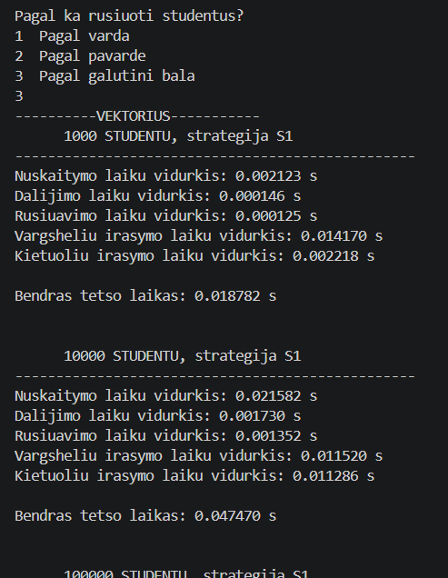

# Studentų pažymių skaičiavimo programa

Objektinio programavimo kurso darbas. Programa leidžia surinkti studentų namų darbų ir egzamino
pažymius (įvedant ranka, sugeneruojant atsitiktinai arba nuskaitant iš failo) ir apskaičiuoja
galutinį balą dviem būdais – pagal namų darbų **vidurkį** ir pagal jų **medianą**.

- **v0.2** – studentų skirstymas į dvi grupes, rūšiavimas, rašymas į failus, laiko matavimas.
- **v0.3** – visos funkcijos veikia ir su `std::vector`, ir su `std::list`; konteinerių palyginimas.
- **v1.0** – trys studentų dalijimo strategijos (+ papildoma „Mano“), efektyvūs STL algoritmai, `CMakeLists.txt`.
- **v1.1** – struktūra `Studentas` pakeista **klase** (`Studentas.h` / `Studentas.cpp`): privatūs laukai, konstruktoriai, destruktorius, getteriai / setteriai; atliktas `struct` ir `class` versijų spartos palyginimas ir optimizavimo flag'ų tyrimas.
- **v1.2** – **penkių metodų taisyklė** (Rule of Five) su demonstracija meniu, **perdengti `>>` ir `<<` operatoriai**
darbui su `Studentas`, galutiniai balai skaičiuojami automatiškai pačioje klasėje.
- **v1.5** – vietoje vienos klasės sukurtos dvi: **abstrakti bazinė klasė `Zmogus`** ir iš jos išvestinė klasė `Studentas`.
  Abstrakčios klasės objekto sukurti negalima; `Studentas` palaiko v1.2 realizuotą trejų (penkių) metodų taisyklę, o programos
  veikimo logika išlieka tokia pati kaip v1.2.


Galutinio balo formulės:

```
galutinis (vid.) = 0.4 * namų darbų vidurkis + 0.6 * egzaminas
galutinis (med.) = 0.4 * namų darbų mediana + 0.6 * egzaminas
```

Galutinis balas suapvalinamas iki dviejų skaitmenų po kablelio.

---

## Turinys

- [Kas naujo v1.5](#kas-naujo-v15)
- [Kas naujo v1.2](#kas-naujo-v12)
- [Diegimas ir paleidimas](#diegimas-ir-paleidimas)
- [Projekto failai](#projekto-failai)
- [Klasių hierarchija: Zmogus ir Studentas (v1.5)](#klasių-hierarchija-zmogus-ir-studentas-v15)
  - [Abstrakti klasė Zmogus](#abstrakti-klasė-zmogus)
  - [Išvestinė klasė Studentas](#išvestinė-klasė-studentas)
- [Penkių metodų taisyklė (Rule of Five)](#penkių-metodų-taisyklė-rule-of-five)
  - [Metodų aprašymas](#metodų-aprašymas)
  - [Demonstracija (meniu punktas 6)](#demonstracija-meniu-punktas-6)
- [Perdengti įvesties ir išvesties operatoriai](#perdengti-įvesties-ir-išvesties-operatoriai)
  - [Duomenų įvestis](#duomenų-įvestis)
  - [Duomenų išvestis](#duomenų-išvestis)
- [Naudojimo instrukcija](#naudojimo-instrukcija)
- [Duomenų failo formatas](#duomenų-failo-formatas)
- [Dalijimo strategijos](#dalijimo-strategijos)
- [Tyrimas (v1.1)](#tyrimas-v11)
  - [Metodika](#metodika)
  - [struct (v1.0) ir class (v1.1) palyginimas](#struct-v10-ir-class-v11-palyginimas)
  - [Optimizavimo flag'ų tyrimas](#optimizavimo-flago-tyrimas)
  - [v1.1 rezultatai pagal strategijas ir konteinerius](#v11-rezultatai-pagal-strategijas-ir-konteinerius)
  - [Išvados](#išvados)
- [Versijos (releases)](#versijos-releases)


---
 
## Kas naujo v1.5
 
| Pakeitimas | Aprašymas |
|---|---|
| Bazinė klasė `Zmogus` | Nauja klasė, kuri aprašo bendrus žmogaus duomenis (`vardas_`, `pavarde_`) ir jų getterius / setterius. Klasė **abstrakti**, nes turi gryną virtualią funkciją `virtual void spausdinti() const = 0;` – `Zmogus` tipo objekto sukurti negalima. |
| Išvestinė klasė `Studentas` | `class Studentas : public Zmogus` paveldi vardą ir pavardę, o pati saugo tik su mokymusi susijusius duomenis (namų darbus, egzaminą, galutinius balus). Funkciją `spausdinti()` perdengia (`override`). |
| Virtualus destruktorius | `Zmogus` destruktorius yra `virtual`, todėl objektas, sunaikinamas per rodyklę į `Zmogus`, sunaikinamas teisingai. |
| Penkių metodų taisyklė | Kiekviena klasė turi savo konstruktorių, kopijavimo ir perkėlimo konstruktorius, kopijavimo ir perkėlimo priskyrimo operatorius bei destruktorių. `Studentas` bazinę dalį perduoda `Zmogus` metodams. |
| Veikimo logika | Meniu, įvestis, išvestis, dalijimo strategijos ir failai nepasikeitė – programa veikia kaip v1.2. |
 


---

## Kas naujo v1.2
 
| Pakeitimas | Aprašymas |
|---|---|
| Penkių metodų taisyklė | Klasėje `Studentas` realizuoti ir **demonstruojami** visi metodai: konstruktorius, kopijavimo konstruktorius, perkėlimo konstruktorius, kopijavimo priskyrimo operatorius, perkėlimo priskyrimo operatorius ir destruktorius. Demonstracija – meniu punktas **6**. |
| Perdengti `>>` ir `<<` | `operator>>` nuskaito studento vardą ir pavardę iš srauto, `operator<<` išveda studento eilutę (vardas, pavardė, galutinis pagal vidurkį ir pagal medianą). Naudojami įvedant studentą ir demonstracijoje. |
| Automatinis balų skaičiavimas | Galutiniai balai perskaičiuojami pačioje klasėje: konstruktoriuje ir kiekvieną kartą, kai pasikeičia namų darbai ar egzaminas (privatus metodas `perskaiciuoti()`). Skaičiavimas atliekamas draugiškomis funkcijomis `Vidurkis()` ir `Mediana()`. |
| Meniu | Pridėtas naujas Konstruktorių demonstracijos punktas, „Išeiti“ tapo punktu 7. |
 

 
---


## Diegimas ir paleidimas

**Reikalavimai:** C++17 palaikantis kompiliatorius (`g++`, `clang++` arba MSVC) ir CMake ≥ 3.10.
C++17 reikalingas dėl `if constexpr` ir `is_same_v`, naudojamų šablonuose.

### Su CMake (rekomenduojama)

```
git clone https://github.com/anzhelina-kaminskaite2198/Objektinis2.git
cd Objektinis2

cmake -S . -B build
cmake --build build
```

Paleidimas:

| Aplinka | Komanda |
|---|---|
| Linux / macOS / MinGW | `./build/studentai` |
| Windows (Visual Studio generatorius) | `cmake --build build --config Release`, tada `build\Release\studentai.exe` |

Pagal nutylėjimą kompiliuojama **Release** režimu (su optimizacijomis), nes tik tokiu būdu laiko
matavimai turi prasmę. Jei Windows sistemoje CMake nerodo kompiliatoriaus (`nmake` klaida),
nurodykite generatorių: `cmake -S . -B build -G "MinGW Makefiles"`.

**Kompiliavimas su pasirinktu optimizavimo lygiu** (naudota flag'ų tyrime):

```
cmake -S . -B build_O1 -DCMAKE_BUILD_TYPE=Release -DCMAKE_CXX_FLAGS_RELEASE="-O1"
cmake --build build_O1
```

Analogiškai su `-O2` ir `-O3`.

### Be CMake (tik g++)

```
g++ -std=c++17 -O2 main.cpp TestiniaiFailai.cpp Studentas.cpp -o studentai
./studentai
```

> **Pastaba apie spalvas.** Programa klaidoms paryškinti naudoja ANSI spalvų kodus (`\033[31m`).
> Windows `cmd.exe` jie gali būti rodomi kaip nesuprantami simboliai – rekomenduojama naudoti
> Windows Terminal, PowerShell 7 arba Git Bash.
>
> **Pastaba apie kompiliavimą.** Jei pamirštamas `TestiniaiFailai.cpp`, rodoma klaida
> `undefined reference to SukurtiVisusTestavimoFailus()`; jei pamirštamas `Studentas.cpp` – klaidos dėl
> `Studentas` metodų.

---

## Projekto failai

| Failas | Kas jame yra |
|---|---|
| `CMakeLists.txt` | Projekto surinkimo aprašas (C++17, Release pagal nutylėjimą) |
| `Studentas.h` | Abstrakčios bazinės klasės `Zmogus` ir išvestinės klasės `Studentas` deklaracijos (laukai, penkių metodų taisyklės metodai, getteriai / setteriai, draugiškos funkcijos ir operatoriai) |
| `Studentas.cpp` | Abiejų klasių realizacija: `Zmogus` metodai, `Studentas` konstruktoriai, priskyrimo operatoriai, destruktorius, `perskaiciuoti()`, `spausdinti()`, `>>` / `<<` operatoriai, `Vidurkis()` ir `Mediana()` |
| `Strukturos.h` | Klasė `NeteisingiDuomenys` ir laiko matavimo struktūra `Laikmatis` |
| `StudentuFunkcijos.h` | Studentų funkcijos: įvedimas, skaitymas iš failo, dalijimo strategijos, rūšiavimas, įrašymas, testų paleidimas ir `RuleOfFive()` demonstracija (daugelis – šablonai) |
| `TestiniaiFailai.cpp` | Atsitiktinių testinių failų kūrimas |
| `main.cpp` | Meniu ir programos eiga |

---

## Klasių hierarchija: Zmogus ir Studentas (v1.5)
 
Ankstesnėse versijose vienoje klasėje buvo ir bendri žmogaus duomenys (vardas, pavardė), ir studento duomenys (pažymiai).
Versijoje v1.5 jie atskirti: bendra dalis perkelta į bazinę klasę, o studentui specifinė – paliko išvestinėje klasėje.
 
```
   Zmogus            (abstrakti klasė, objektų kurti negalima)
      ▲
      │  public paveldėjimas
   Studentas         (konkreti klasė, objektus kurti galima)
```
 
| | `Zmogus` (bazinė, abstrakti) | `Studentas` (išvestinė) |
|---|---|---|
| Laukai | `vardas_`, `pavarde_` (`protected`) | `namuDarbai_`, `egzaminas_`, `galutinisVid_`, `galutinisMed_` (`private`) |
| Konstruktoriai ir priskyrimas | konstruktorius, kopijavimo ir perkėlimo konstruktoriai, kopijavimo ir perkėlimo priskyrimas | tas pats, bet bazinę dalį perduoda `Zmogus` metodams |
| Destruktorius | `virtual ~Zmogus()` | `~Studentas() override` |
| Getteriai / setteriai | `vardas()`, `pavarde()`, `setVardas()`, `setPavarde()` | `namuDarbai()`, `egzaminas()`, `galutinisVid()`, `galutinisMed()`, `setNamuDarbai()`, `pridetiND()`, `setEgzaminas()`, `setGalutinisVid()`, `setGalutinisMed()` |
| `spausdinti()` | `virtual void spausdinti() const = 0;` (gryna virtuali) | `void spausdinti() const override;` |
| Draugiškos funkcijos | – | `operator>>`, `operator<<`, `Vidurkis()`, `Mediana()` |
 
Vardas, pavardė ir jų getteriai / setteriai nėra deklaruoti `Studentas` klasėje – jie **paveldimi**, todėl
`studentas.vardas()` ar `studentas.setPavarde(...)` veikia taip pat kaip v1.2.
 
### Abstrakti klasė Zmogus
 
```cpp
class Zmogus {
protected:
    string vardas_;
    string pavarde_;
public:
    Zmogus(string v = "", string p = "");
    Zmogus(const Zmogus& o);
    Zmogus(Zmogus&& o) noexcept;
    Zmogus& operator=(const Zmogus& o);
    Zmogus& operator=(Zmogus&& o) noexcept;
 
    virtual ~Zmogus();
 
    const string& vardas() const;
    const string& pavarde() const;
    void setVardas(const string& v);
    void setPavarde(const string& p);
 
    virtual void spausdinti() const = 0;     // gryna virtuali funkcija
};
```
 
- **Kodėl klasė abstrakti.** Joje yra gryna virtuali funkcija `spausdinti() = 0`, kuri neturi realizacijos. Tokią klasę
  kompiliatorius leidžia naudoti tik kaip bazinę – objektų kurti negalima, o kiekviena išvestinė klasė privalo funkciją realizuoti,
  kad pati nebūtų abstrakti. `Studentas` tai daro: `spausdinti()` išveda studentą per perdengtą `operator<<`.
- **`protected` laukai.** `vardas_` ir `pavarde_` prieinami išvestinei klasei (pvz. `operator>>` ir `operator<<`, kurie yra
  `Studentas` draugai, juos skaito ir rašo), bet ne išorinėms funkcijoms.
- **Virtualus destruktorius.** Jei objektas, sukurtas kaip `Studentas`, būtų naikinamas per `Zmogus*`, be `virtual` būtų iškviestas tik
  bazinės klasės destruktorius ir `Studentas` dalis nebūtų sutvarkyta.
**Abstrakčios klasės demonstracija.** `main.cpp` pradžioje yra užkomentuota eilutė:
 
```cpp
int main() {
    //Zmogus zmogus;      // <-- atkomentavus programa nebesikompiliuoja
```
 
Atkomentavus ją kompiliatorius nutraukia kompiliavimą ir praneša, kad `Zmogus` yra abstraktus tipas
(g++ tekstas: `cannot declare variable 'zmogus' to be of abstract type 'Zmogus'`, o po juo – `virtual void Zmogus::spausdinti() const` yra gryna virtuali funkcija):
 

 
Nuotraukoje matoma, kad tiesiogiai sukurti `Zmogus` objekto negalima. Po patikrinimo eilutė vėl užkomentuota, kad programa kompiliuotųsi.
 
### Išvestinė klasė Studentas
 
```cpp
class Studentas : public Zmogus {
private:
    vector<double> namuDarbai_;
    double egzaminas_;
    double galutinisVid_;
    double galutinisMed_;
    void perskaiciuoti();                                //perskaičiuoja galutinius balus
 
public:
    Studentas(string v = "", string p = "", vector<double> nd = {}, double egz = 0);
    Studentas(const Studentas& o);                       // kopijavimo konstruktorius
    Studentas(Studentas&& o) noexcept;                   // perkėlimo konstruktorius
    Studentas& operator=(const Studentas& o);            // kopijavimo priskyrimas
    Studentas& operator=(Studentas&& o) noexcept;        // perkėlimo priskyrimas
    ~Studentas() override;                               // destruktorius
 
    const vector<double>& namuDarbai() const;
    double egzaminas() const;  double galutinisVid() const;  double galutinisMed() const;
    void setNamuDarbai(vector<double>);  void pridetiND(double);
    void setEgzaminas(double);  void setGalutinisVid(double);  void setGalutinisMed(double);
 
    friend istream& operator>>(istream&, Studentas&);
    friend ostream& operator<<(ostream&, const Studentas&);
    friend double Vidurkis(const Studentas&);
    friend double Mediana(const Studentas&);
 
    void spausdinti() const override;
};
```
 
- **Konstruktorius** su numatytosiomis reikšmėmis kartu veikia ir kaip numatytasis (`Studentas s;`). Vardą ir pavardę perduoda
  `Zmogus(move(v), move(p))`, o galutiniai balai (`galutinisVid_`, `galutinisMed_`) apskaičiuojami iš karto.
- **Automatinis perskaičiavimas.** `setNamuDarbai()`, `pridetiND()` ir `setEgzaminas()` po pakeitimo kviečia privatų
  `perskaiciuoti()`, todėl galutiniai balai niekada nelieka pasenę. `setGalutinisVid()` ir `setGalutinisMed()` reikšmę nustato tiesiogiai.
- **`override`.** `~Studentas() override` ir `spausdinti() const override` – kompiliatorius patikrina, kad jie tikrai perdengia
  bazinės klasės virtualias funkcijas.
- **`Vidurkis()` ir `Mediana()`** – draugiškos funkcijos, kurios tiesiogiai skaito privačius laukus. Jei namų darbų nėra, jų
  vidurkis / mediana laikoma 0; rezultatas suapvalinamas iki 2 skaitmenų po kablelio.
- Klasė `NeteisingiDuomenys` (blogi įrašai skaitant iš failo) yra atskira klasė su getteriais ir setteriais.
---

## Penkių metodų taisyklė (Rule of Five)
 
Klasė valdo dinaminę atmintį per `string` ir `vector`, todėl realizuota ne tik trijų metodų taisyklė
(destruktorius, kopijavimo konstruktorius, kopijavimo priskyrimas), bet ir jos išplėtimas – **penkių metodų taisyklė**,
pridedanti perkėlimo konstruktorių ir perkėlimo priskyrimą. Kartu su paprastu konstruktoriumi viso demonstruojama šešių metodų.

### Metodų aprašymas
 
| # | Metodas | Deklaracija | Ką daro | Kur naudojamas programoje |
|---|---|---|---|---|
| 1 | Konstruktorius | `Studentas(string v = "", string p = "", vector<double> nd = {}, double egz = 0)` | Sukuria studentą: `move` perima vardą, pavardę ir namų darbus, nustato egzaminą, apskaičiuoja abu galutinius balus | `Studentas studentas;` (`IvestiStudenta`), `Studentas(move(vardas), move(pavarde), move(nd), egz)` (`SkaitytiIsFailo`) |
| 2 | Kopijavimo konstruktorius | `Studentas(const Studentas& o)` | Sukuria **nepriklausomą kopiją**: nukopijuoja visus laukus, įskaitant jau apskaičiuotus galutinius balus | `studentai.push_back(studentas)` (`IvestiStudenta`), strategija S1 (`vargseliai.push_back(studentas)`) |
| 3 | Perkėlimo konstruktorius | `Studentas(Studentas&& o) noexcept` | Perima iš `o` vardą, pavardę ir namų darbų vektorių (`move`, be kopijavimo); `double` reikšmės nukopijuojamos. Šaltinio `string` ir `vector` lieka tušti | `push_back(move(studentas))` (`SkaitytiIsFailo`), strategijos S2, Mano, Optimizuota; `vector` plečiantis |
| 4 | Kopijavimo priskyrimo operatorius | `Studentas& operator=(const Studentas& o)` | Nukopijuoja visus laukus į jau egzistuojantį objektą; patikrina, ar nepriskiriama sau (`this != &o`) | `RuleOfFive()` demonstracija |
| 5 | Perkėlimo priskyrimo operatorius | `Studentas& operator=(Studentas&& o) noexcept` | Kaip perkėlimo konstruktorius, bet į jau egzistuojantį objektą; taip pat tikrina `this != &o` | `RuleOfFive()` demonstracija; elementų perstūmimas `remove_if` ir rūšiavimo metu |
| 6 | Destruktorius | `~Studentas()` | Išvalo `vardas_`, `pavarde_`, `namuDarbai_` ir nustato `egzaminas_`, `galutinisVid_`, `galutinisMed_` į 0 | Automatiškai kiekvieno objekto gyvavimo pabaigoje |
 
Perkėlimo metodai pažymėti `noexcept`, kad `std::vector` plečiantis perkeltų, o ne kopijuotų elementus. Būtent jų dėka
strategijos S2, Mano ir Optimizuota perkelia studentus tarp konteinerių, o ne kopijuoja (žr. [Dalijimo strategijos](#dalijimo-strategijos)).
Kai deklaruotas destruktorius, kompiliatorius perkėlimo operacijų pats nesugeneruoja – todėl jos parašytos rankiniu būdu.
 
### Demonstracija (meniu punktas 6)
 
Pasirinkus **6 Konstruktorių demonstracija** paleidžiama funkcija `RuleOfFive()`. Ji žingsnis po žingsnio sukuria
studentus ir po kiekvieno veiksmo išveda abu dalyvaujančius objektus, naudodama perdengtą `operator<<`:
 
| Žingsnis | Kodas | Ką matome |
|---|---|---|
| 1. Paprastas konstruktorius | `Studentas s1("Jonas", "Jonaitis", {8, 9, 10}, 9);` | Sukurtas `s1` su apskaičiuotais galutiniais balais |
| 2. Kopijavimo konstruktorius | `Studentas s2(s1);` | `s2` – tokia pati kopija; `s1` nepasikeitė |
| 3. Perkėlimo konstruktorius | `Studentas s3(move(s1));` | `s3` turi `s1` duomenis, o `s1` vardas ir pavardė tapo **tušti** |
| 4. Kopijavimo priskyrimas | `Studentas s4; s4 = s2;` | `s4` tapo `s2` kopija; `s2` nepasikeitė |
| 5. Perkėlimo priskyrimas | `Studentas s5; s5 = move(s3);` | `s5` turi `s3` duomenis, o `s3` vardas ir pavardė tapo **tušti** |
 

 
Išvada: kopijuojant pradinis objektas lieka nepakitęs, o perkeliant jo `string` ir `vector` laukai „ištuštinami“ –
duomenys perduodami be kopijavimo, todėl perkėlimas yra greitesnis.
 
---
 
## Perdengti įvesties ir išvesties operatoriai
 
Klasei `Studentas` perdengti du operatoriai, deklaruoti kaip `friend` (kad galėtų pasiekti privačius laukus):
 
```cpp
istream& operator>>(istream& in, Studentas& a);          // nuskaito vardą ir pavardę
ostream& operator<<(ostream& out, const Studentas& a);   // išveda studento eilutę
```
 
| Operatorius | Ką daro | Kur naudojamas |
|---|---|---|
| `operator>>` | Iš srauto nuskaito du žodžius – **vardą** ir **pavardę** – ir įrašo juos į studento laukus | `IvestiStudenta()`: `cin >> studentas;` |
| `operator<<` | Išveda vieną lentelės eilutę: vardas (plotis 15), pavardė (20), galutinis pagal vidurkį (20) ir pagal medianą (20), su 2 skaitmenimis po kablelio | `IvestiStudenta()` (įvedus studentą), `RuleOfFive()` (demonstracija) |
 
Namų darbų ir egzamino pažymiai per `operator>>` nenuskaitomi: jiems reikia atskiro tikrinimo (intervalas [0; 10],
tuščia eilutė, ne skaičius), todėl jie apdorojami `IvestiStudenta()` funkcijoje.
 
### Duomenų įvestis
 
Programoje yra trys duomenų įvedimo būdai:
 
| Būdas | Kaip veikia | Kas naudojama |
|---|---|---|
| **Rankiniu būdu** | Vardas ir pavardė nuskaitomi per `cin >> studentas` (perdengtas `operator>>`). Namų darbų pažymiai įvedami po vieną (baigiama paspaudus ENTER tuščioje eilutėje), egzamino pažymys – vienas. Kiekvienas pažymys tikrinamas: turi būti skaičius iš [0; 10], kitaip rodoma klaida ir prašoma įvesti dar kartą. Jei egzaminas įvedamas ir paspaudžiamas tik ENTER, jis laikomas 0 | `IvestiStudenta()`, `pridetiND()`, `setEgzaminas()` |
| **Automatiniu (atsitiktiniu)** | Vardas ir pavardė įvedami ranka, o namų darbų pažymiai (vartotojo nurodytas kiekis) ir egzamino pažymys sugeneruojami atsitiktinai – realūs skaičiai iš [0; 10], išvedami su 2 skaitmenimis po kablelio. Generatorius – `mt19937` | `IvestiStudenta()`, `uniform_real_distribution` |
| **Iš failo** | Nuskaitoma visa lentelė: pirma eilutė (antraštė) praleidžiama, kiekvienoje eilutėje pirmi du žodžiai – vardas ir pavardė, visi tolesni skaičiai – pažymiai, **paskutinis** – egzaminas. Eilutės su blogais pažymiais atmetamos ir surenkamos į sąrašą `neteisingi` | `SkaitytiIsFailo()` (`ifstream` + `stringstream`) |
 

 

 

 
### Duomenų išvestis
 
| Būdas | Kaip veikia | Kas naudojama |
|---|---|---|
| **Į ekraną** | Įvedus naują studentą išvedama lentelė su vardu, pavarde, galutiniais balais ir objekto **adresu atmintyje**. Eilutė formuojama perdengtu `operator<<`. Taip pat į ekraną išvedami laikai, klaidų pranešimai ir blogų įrašų sąrašas | `cout << studentas`, `RuleOfFive()` |
| **Į failą** | Padalinti ir surūšiuoti studentai įrašomi į `vargseliai.txt` ir `kietuoliai.txt`: antraštė, brūkšnių eilutė ir po vieną eilutę kiekvienam studentui (vardas, pavardė, galutinis pagal vidurkį ir medianą, 2 skaitmenys po kablelio). Eilutės formatas toks pat kaip ir `operator<<` išvedamas į ekraną | `IrasytiStudentus()` (`ofstream` + getteriai) |
 

 

 
---
 
## Naudojimo instrukcija

Paleidus programą rodomas meniu:

```
              MENIU
-----------------------------------
1  Ivesti nauja studenta
2  Nuskaityti duomenis is failo
3  Padalinti, surusiuoti ir irasyti studentus i failus
4  Sukurti testavimo failus (5 failai)
5  Paleisti testavimus (5 failai)
6  Konstruktriu demonstracija
7  Iseiti
```

**Rekomenduojama eiga tyrimui:** `4` (sukuria testinius failus vieną kartą) → `5` (paleidžia testus) → `7`.

1. **Įvesti naują studentą** – prašoma vardo ir pavardės, tada pasirenkama, ar namų darbų pažymius
   įvesti ranka (baigiama paspaudus ENTER tuščioje eilutėje), ar sugeneruoti atsitiktinai. Tas pats
   pasirinkimas galioja egzaminui; jei egzaminas įvedamas ranka ir paspaudžiamas tik ENTER, jis laikomas 0.
   Išvedamas ir studento objekto adresas atmintyje (`&studentai.back()`).
2. **Nuskaityti duomenis iš failo** – prašoma failo pavadinimo (pvz. `kursiokai.txt`). Paskutinis
   eilutės skaičius laikomas egzamino pažymiu, visi prieš jį – namų darbais. Parodomas nuskaitymo
   laikas ir, jei buvo blogų įrašų, jų sąrašas.
3. **Padalinti, surūšiuoti ir įrašyti** – pasirenkama, pagal ką rūšiuoti (vardą, pavardę ar galutinį
   balą); studentai padalinami į dvi grupes (naudojama greičiausia strategija – `Optimizuota`),
   kiekviena grupė surūšiuojama ir įrašoma į `vargseliai.txt` / `kietuoliai.txt`.
   **Po šio žingsnio pradinis sąrašas tampa tuščias** – norint kartoti, duomenis reikia nuskaityti iš naujo.
4. **Sukurti testavimo failus** – žr. [Testiniai failai](#testiniai-failai).
5. **Paleisti testavimus** – kiekvienai strategijai, kiekvienam konteineriui (`vector`, `list`) ir
   kiekvienam iš 5 failų atliekamas skaitymas, dalijimas, rūšiavimas ir įrašymas (3 kartai), išvedami laikų vidurkiai.
6. **Konstruktorių demonstracija** – parodo visus penkių metodų taisyklės metodus veikiant
   (žr. [Demonstracija](#demonstracija-meniu-punktas-6)).
7. **Išeiti**.






### Testiniai failai

| Failas | Studentų skaičius | ND stulpelių |
|---|---|---|
| `studentai1000.txt` | 1 000 | 3 |
| `studentai10000.txt` | 10 000 | 4 |
| `studentai100000.txt` | 100 000 | 5 |
| `studentai1000000.txt` | 1 000 000 | 6 |
| `studentai10000000.txt` | 10 000 000 | 7 |

Vardai ir pavardės: `Vardas1`, `Pavarde1`, ...; pažymiai – atsitiktiniai sveikieji nuo 0 iki 10.
Failai sukuriami **vieną kartą** ir naudojami visiems testams, kad palyginimas būtų sąžiningas.
Didžiausias failas (10 mln. įrašų) užima daug vietos diske ir daug RAM apdorojant (ypač S1 strategija, kuri
laiko dvi studentų kopijas).

### Įvesties tikrinimas

- Netinkamas meniu pasirinkimas – srautas išvalomas ir meniu rodomas iš naujo (`IvedimoKlaidos()`).
- Pažymys turi būti skaičius intervale **[0; 10]**; tekstas vietoj skaičiaus gaudomas per `std::invalid_argument`.
- Generuojamų namų darbų skaičius negali būti neigiamas.
- Neegzistuojantis failas – parodomas pranešimas, grįžtama į meniu.
- Eilutės su blogais pažymiais į sąrašą nepatenka, o surenkamos į `neteisingi` ir parodomos vartotojui.

---

## Duomenų failo formatas

Pirma eilutė – antraštė (praleidžiama). Toliau kiekviena eilutė – vienas studentas:

```
Vardas        Pavarde        ND1   ND2   ND3   ND4   ND5   Egz.
Vardas1       Pavarde1       8     9     7     3     3     10
```

Namų darbų skaičius iš anksto nežinomas – skaitomi visi eilutės skaičiai, **paskutinis** priskiriamas
egzaminui. Stulpelių skaičius eilutėse gali skirtis, skirtukai – bet koks tarpų kiekis.

---

## Dalijimo strategijos

Studentai skirstomi pagal galutinį balą (pagal vidurkį): **< 5.0 – „vargšeliai“**, **≥ 5.0 – „kietuoliai“**.
Strategijos nesikeitė nuo v1.0.

| Strategija | Aprašymas | `vector` | `list` |
|---|---|---|---|
| **S1** | Bendras konteineris skaidomas į du **naujus** konteinerius, studentai **kopijuojami** (`partition_copy`). Studentas yra dviejuose konteineriuose (bendrame ir naujame) – didžiausias atminties naudojimas. | `partition_copy` | `partition_copy` |
| **S2** | Naudojamas tik vienas naujas konteineris („vargšeliai“); vargšeliai perkeliami į jį ir **ištrinami** iš bendro, kuriame lieka kietuoliai. | Rūšiavimas pagal balą ir `pop_back()` vargšelių | `erase` ciklu |
| **Mano** | Vienas praėjimas, kiekvienas studentas **perkeliamas** (ne kopijuojamas) į vieną iš dviejų naujų konteinerių. | `count_if` + `reserve` + `partition_copy` su `move_iterator` | `splice` į abu konteinerius |
| **Optimizuota (S3)** | Greičiausios strategijos (S1/S2) variantas su efektyviais STL algoritmais. | `copy_if` + `remove_if` (judinami elementai) | `splice` tik vargšelių, likęs konteineris perimamas per `move` |

**Naudoti algoritmai:** `std::partition_copy`, `std::copy_if`, `std::remove_if`, `std::count_if`, `std::sort`
(`vector`), `std::list::sort`, `std::list::splice`, `std::make_move_iterator`.

---

## Tyrimas (v1.1)

### Metodika

- Failai: `studentai1000.txt` ... `studentai10000000.txt`, sugeneruoti vieną kartą ir naudoti visiems testams.
- Kiekvienam failui, konteineriui ir strategijai testas kartojamas **3 kartus**, pateikiamas **vidurkis** (sekundėmis).
- Matuojami etapai: nuskaitymas, dalijimas, rūšiavimas (pagal galutinį balą), vargšelių ir kietuolių įrašymas į failus.
  Bendras laikas – šių etapų suma.
- Kompiliavimas: C++17, Release. `struct` versija (v1.0) matuota su `-O2`; `class` versija (v1.1) – taip pat `-O2`.
- Palyginimas `struct` ir `class`: **vienas fiksuotas konteineris – `std::vector`**, **greičiausia dalijimo strategija – `Optimizuota`**,
  failai su 100 000 ir 1 000 000 studentų. `struct` rezultatai paimti iš v1.0 (`git checkout v1.0`), `class` – iš v1.1.

### struct (v1.0) ir class (v1.1) palyginimas

`std::vector`, strategija `Optimizuota`, laikai sekundėmis (3 testų vidurkis). Paskutiniame stulpelyje – `class` laikas,
padalintas iš `struct` laiko (> 1 reiškia, kad `class` lėtesnė).

| Etapas | struct (v1.0) | class (v1.1) | class / struct |
|---|---|---|---|
| **100 000 studentų** | | | |
| Nuskaitymas | 0.157542 | 0.168596 | 1.07 |
| Dalijimas | 0.005614 | 0.005401 | 0.96 |
| Rūšiavimas | 0.014289 | 0.016959 | 1.19 |
| Vargšelių įrašymas | 0.076373 | 0.080045 | 1.05 |
| Kietuolių įrašymas | 0.072466 | 0.075546 | 1.04 |
| **Bendras** | **0.326282** | **0.346547** | 1.06 |
| **1 000 000 studentų** | | | |
| Nuskaitymas | 1.923079 | 2.018468 | 1.05 |
| Dalijimas | 0.043173 | 0.046886 | 1.09 |
| Rūšiavimas | 0.192033 | 0.225865 | 1.18 |
| Vargšelių įrašymas | 0.590214 | 0.757712 | 1.28 |
| Kietuolių įrašymas | 0.609687 | 0.725917 | 1.19 |
| **Bendras** | **3.358187** | **3.774848** | 1.12 |

Papildomai – santykis `class / struct` kitiems failų dydžiams (tas pats konteineris ir strategija):

| Studentų sk. | Dalijimas (class / struct) | Rūšiavimas (class / struct) | Bendras (class / struct) |
|---|---|---|---|
| 1 000 | 0.93 | 0.96 | 0.80 |
| 10 000 | 1.05 | 1.33 | 0.69 |
| 100 000 | 0.96 | 1.19 | 1.06 |
| 1 000 000 | 1.09 | 1.18 | 1.12 |
| 10 000 000 | 1.16 | 1.17 | 1.22 |

**Pastebėjimai:**

- Su `class` programa veikia apie **6 % lėtesnė** esant 100 000 įrašų ir apie **12 % lėtesnė** esant 1 000 000 įrašų.

### Optimizavimo flag'ų tyrimas

`std::vector`, strategija `Optimizuota`, 3 testų vidurkis.

| Flag | Versija | 1 000 bendras (s) | 10 000 bendras (s) | 100 000 bendras (s) | 1 000 000 bendras (s) | 10 000 000 bendras (s) | Exe dydis(KB) |
|---|---|---|---|---|---|---|---|
| -O1 | struct (v1.0) | 0.011142 | 0.038302 | 0.329136 | 3.609054 | 37.879440 | 432 |
| -O1 | class (v1.1) | 0.012221 | 0.046800 | 0.422897 | 3.954720 | 48.878690 | 402 |
| -O2 | struct (v1.0) | 0.012656 | 0.061272 | 0.538387 | 5.391878 | 56.506400 | 392 |
| -O2 | class (v1.1) | 0.011639 | 0.035266 | 0.346547 | 3.774848 | 42.756858 | 380 |
| -O3 | struct (v1.0) | 0.020217 | 0.062437 | 0.526834 | 5.240572 | 56.162429 | 393 |
| -O3 | class (v1.1) | 0.011012 | 0.062824 | 0.553133 | 5.719030 | 62.990706 | 377 |


### v1.1 rezultatai pagal strategijas ir konteinerius

Visi laikai – sekundėmis, 3 testų vidurkis. Greičiausia strategija kiekvienoje eilutėje pažymėta **paryškintai**.

**Dalijimo laikas, `std::vector`**

| Studentų sk. | S1 | S2 | Mano | Optimizuota |
|---|---|---|---|---|
| 1 000 | 0.000147 | 0.000191 | 0.000099 | **0.000041** |
| 10 000 | 0.001749 | 0.002039 | 0.000676 | **0.000496** |
| 100 000 | 0.012416 | 0.023234 | 0.007989 | **0.005401** |
| 1 000 000 | 0.108851 | 0.279057 | 0.065676 | **0.046886** |
| 10 000 000 | 1.663611 | 3.410351 | 0.997732 | **0.593966** |

**Dalijimo laikas, `std::list`**

| Studentų sk. | S1 | S2 | Mano | Optimizuota |
|---|---|---|---|---|
| 1 000 | 0.000145 | 0.000059 | 0.000169 | **0.000046** |
| 10 000 | 0.001301 | 0.000494 | 0.001198 | **0.000303** |
| 100 000 | 0.013621 | 0.005028 | 0.011882 | **0.002552** |
| 1 000 000 | 0.150183 | 0.057492 | 0.130821 | **0.025817** |
| 10 000 000 | 1.929788 | 0.518276 | 2.070263 | **0.240221** |

**Bendras testo laikas, `std::vector`**

| Studentų sk. | S1 | S2 | Mano | Optimizuota |
|---|---|---|---|---|
| 1 000 | 0.014196 | 0.012283 | 0.013361 | **0.011639** |
| 10 000 | 0.039019 | 0.038645 | 0.038164 | **0.035266** |
| 100 000 | 0.344015 | 0.348790 | **0.340309** | 0.346547 |
| 1 000 000 | **3.535742** | 3.884839 | 3.758004 | 3.774848 |
| 10 000 000 | **40.356607** | 42.356384 | 40.691542 | 42.756858 |

**Bendras testo laikas, `std::list`**

| Studentų sk. | S1 | S2 | Mano | Optimizuota |
|---|---|---|---|---|
| 1 000 | 0.012548 | 0.012666 | **0.012431** | 0.012800 |
| 10 000 | 0.038508 | **0.035210** | 0.037152 | 0.038405 |
| 100 000 | 0.399124 | **0.358147** | 0.366849 | 0.399609 |
| 1 000 000 | 4.604206 | 4.127696 | 4.091612 | **4.005150** |
| 10 000 000 | 49.944465 | **47.262218** | 48.655513 | 47.698730 |

**Visų etapų laikai, `std::vector`, strategija `Optimizuota`**

| Studentų sk. | Nuskaitymas | Dalijimas | Rūšiavimas | Vargšelių įrašymas | Kietuolių įrašymas | Bendras |
|---|---|---|---|---|---|---|
| 1 000 | 0.001971 | 0.000041 | 0.000125 | 0.005119 | 0.004384 | 0.011639 |
| 10 000 | 0.015850 | 0.000496 | 0.001628 | 0.009526 | 0.007766 | 0.035266 |
| 100 000 | 0.168596 | 0.005401 | 0.016959 | 0.080045 | 0.075546 | 0.346547 |
| 1 000 000 | 2.018468 | 0.046886 | 0.225865 | 0.757712 | 0.725917 | 3.774848 |
| 10 000 000 | 22.087157 | 0.593966 | 2.685723 | 8.280149 | 9.109864 | 42.756858 |

**Visų etapų laikai, `std::list`, strategija `Optimizuota`**

| Studentų sk. | Nuskaitymas | Dalijimas | Rūšiavimas | Vargšelių įrašymas | Kietuolių įrašymas | Bendras |
|---|---|---|---|---|---|---|
| 1 000 | 0.003953 | 0.000046 | 0.000090 | 0.006244 | 0.002467 | 0.012800 |
| 10 000 | 0.016671 | 0.000303 | 0.000902 | 0.012061 | 0.008469 | 0.038405 |
| 100 000 | 0.192770 | 0.002552 | 0.024646 | 0.092006 | 0.087635 | 0.399609 |
| 1 000 000 | 2.003227 | 0.025817 | 0.556674 | 0.702155 | 0.717278 | 4.005150 |
| 10 000 000 | 22.236332 | 0.240221 | 9.893432 | 7.334838 | 7.993907 | 47.698730 |

### Išvados

- **struct ir class:** `class` versija šiek tiek lėtesnė (~6 % esant 100 000 ir ~12 % esant 1 000 000 įrašų bendram laikui);
  didžiausias skirtumas matomas rūšiavimo etape (~18–19 %). Klasės privalumai (inkapsuliacija, valdomas objekto gyvavimas)
  atsiperka nedideliu spartos nuostoliu.
- **Dalijimas:** tiek `vector`, tiek `list` atveju greičiausia strategija yra **Optimizuota** visuose failų dydžiuose.
  `vector`, 10 mln. įrašų: Optimizuota 0.593966 s, Mano 0.997732 s, S1 1.663611 s, S2 3.410351 s.
  `list`, 10 mln. įrašų: Optimizuota 0.240221 s, S2 0.518276 s, S1 1.929788 s, Mano 2.070263 s.
- **Bendras laikas:** nuskaitymas ir įrašymas sudaro apie 92–94 % laiko, todėl bendro laiko skirtumai tarp strategijų yra maži (kelių procentų)
  ir ne visada atitinka dalijimo laiko eiliškumą – juos lemia disko sparta ir matavimo paklaida.
- **Rūšiavimas:** `list::sort` nuo 100 000 įrašų lėtesnis už `vector` + `std::sort`; 10 mln. įrašų – 9.893432 s prieš 2.685723 s.

---

## Versijos (releases)

| Versija | Šaka | Trumpai |
|---|---|---|
| `v.pradinė` | `v.pradine` | Įvedimas ranka ir generavimas, vidurkis ir mediana, rezultatų lentelė |
| `v0.1` | `v0.1` | Skaitymas iš failo, blogų įrašų atmetimas, dalinė didelių sąrašų išvestis |
| `v0.2` | `v0.2` | Dalijimas į dvi grupes, rūšiavimo pasirinkimas, rašymas į failus, testiniai failai, laiko matavimas |
| `v0.3` | `v0.3` | Šablonai, `vector` ir `list`, objekto adresas, konteinerių spartos palyginimas |
| `v1.0` | `v1.0` | Dalijimo strategijos S1, S2, Mano, Optimizuota; efektyvūs STL algoritmai; `CMakeLists.txt`; pilnas README |
| `v1.1` | `V1.1` | `struct Studentas` pakeista `class`; `struct` / `class` palyginimas; optimizavimo flag'ų tyrimas |
| `v1.2` | `v1.2` | Penkių metodų taisyklė ir jos demonstracija, perdengti `>>` / `<<` operatoriai, automatinis galutinių balų skaičiavimas |

### v.pradinė

Pirmoji veikianti versija: struktūra `Studentas`, `vector<Studentas>`, įvedimas ranka arba
atsitiktinis generavimas (`rand()`), galutinis balas pagal vidurkį ir medianą, lentelės išvedimas (`<iomanip>`),
įvesties klaidų tikrinimas. Failų skaitymo nebuvo, o visas sąrašas visada buvo išvedamas iš karto.

### v0.1

- Skaitymas iš failo (`SkaitytiIsFailo()`), paskutinis skaičius – egzaminas.
- Blogų įrašų atmetimas (`NeteisingiDuomenys`, `neteisingi`).
- Dalinė išvestis, kai studentų daugiau nei 40 (pirmi ir paskutiniai 20); rikiavimas pagal vardą.
- Pridėtas `.gitignore`, testinis failas `kursiokai.txt` su įterptomis klaidomis, ištaisytos įvedimo klaidos.

### v0.2

- Kodas išskaidytas į `Strukturos.h`, `StudentuFunkcijos.h`, `TestiniaiFailai.cpp`, `main.cpp`.
- Dalijimas į „vargšelius“ ir „kietuolius“ (`std::move`), rūšiavimo pasirinkimas, rašymas į `vargseliai.txt` / `kietuoliai.txt`.
- Testinių failų kūrimas (1 tūkst. – 10 mln.), spartos testavimas (3 kartai), `Laikmatis` su `std::chrono`.
- Galutiniai balai skaičiuojami vieną kartą (`galutinisVid`, `galutinisMed`), `mt19937` vietoje `rand()`.
- Pašalinta dalinė išvestis – rezultatai rašomi į failus.

### v0.3

- Funkcijos paverstos šablonais (`template <typename Container>`), veikia su `vector` ir `list`.
- `if constexpr` pasirenka `std::sort` arba `list::sort`; `shrink_to_fit()` tik `vector`.
- Objekto adreso išvedimas, abiejų konteinerių testavimas vienu paleidimu.
- Realizacijos perkeltos į `StudentuFunkcijos.h`, ne šablonų funkcijos ir globalūs kintamieji pažymėti `inline`.
- Konteinerių tyrimas.

### v1.0

- Realizuotos strategijos **S1**, **S2**, **Mano** ir **Optimizuota** abiem konteineriams (žr. [Dalijimo strategijos](#dalijimo-strategijos)).
- Naudojami efektyvūs algoritmai (`partition_copy`, `copy_if`, `remove_if`, `count_if`, `splice`).
- Testų paleidimas lygina visas strategijas su abiem konteineriais, 3 kartų vidurkis, ankstesnis failų generavimas.
- Pridėtas `CMakeLists.txt` (C++17, Release pagal nutylėjimą) ir diegimo instrukcija.
- README papildytas lentelėmis ir išvadomis.

### v1.1

- `struct Studentas` pakeista **klase** `Studentas` (`Studentas.h` / `Studentas.cpp`): privatūs laukai, konstruktorius,
  kopijavimo ir perkėlimo konstruktoriai bei priskyrimo operatoriai, destruktorius, getteriai ir setteriai, `>>` ir `<<` operatoriai.
- `NeteisingiDuomenys` paversta klase; visas kodas (`StudentuFunkcijos.h`) pritaikytas naudoti getterius ir setterius.
- `CMakeLists.txt` papildytas `Studentas.cpp`.
- Atliktas `struct` (v1.0) ir `class` (v1.1) spartos palyginimas ir optimizavimo flag'ų (`-O1`, `-O2`, `-O3`) tyrimas.

**Apribojimai:** po dalijimo pradinis konteineris išvalomas; `RikiotiStudentus` palaiko tik `vector<Studentas>` ir `list<Studentas>`;
10 mln. įrašų testui reikia kelių GB RAM (ypač S1).

### v1.2
 
- **Penkių metodų taisyklė:** konstruktorius, kopijavimo konstruktorius, perkėlimo konstruktorius, kopijavimo priskyrimas,
  perkėlimo priskyrimas ir destruktorius; visi demonstruojami meniu punkte **6** (`RuleOfFive()`).
- **Perdengti `>>` ir `<<`** darbui su `Studentas`: vardo ir pavardės nuskaitymas, studento eilutės išvedimas.
- Galutiniai balai skaičiuojami automatiškai (`perskaiciuoti()` konstruktoriuje ir setteriuose); `Vidurkis()` ir `Mediana()` – draugiškos funkcijos.
- Meniu papildytas punktu „Konstruktorių demonstracija“, išėjimas perkeltas į punktą 7.
- README papildytas perdengtų metodų, duomenų įvesties ir išvesties aprašymais bei iliustracijomis.
**Apribojimai:** po dalijimo pradinis konteineris išvalomas; `RikiotiStudentus` palaiko tik `vector<Studentas>` ir `list<Studentas>`;
10 mln. įrašų testui reikia kelių GB RAM (ypač S1).

### v1.5
 
- Sukurta **abstrakti bazinė klasė `Zmogus`** (`vardas_`, `pavarde_`, getteriai / setteriai, `virtual ~Zmogus()`, gryna virtuali funkcija `spausdinti() = 0`).
- `Studentas` pakeista **išvestine klase** `class Studentas : public Zmogus`; vardo ir pavardės laukai bei jų metodai paveldimi, `spausdinti()` ir destruktorius perdengti (`override`).
- Abi klasės turi konstruktorių, kopijavimo ir perkėlimo konstruktorius, kopijavimo ir perkėlimo priskyrimo operatorius bei destruktorių; `Studentas` bazinę dalį perduoda `Zmogus` metodams.
- Parodyta, kad `Zmogus` objekto sukurti negalima (kompiliavimo klaida, žr. [Abstrakti klasė Zmogus](#abstrakti-klasė-zmogus)).
- Programos veikimo logika (meniu, įvestis, išvestis, strategijos) nepakito.
**Apribojimai:** po dalijimo pradinis konteineris išvalomas; `RikiotiStudentus` palaiko tik `vector<Studentas>` ir `list<Studentas>`;
10 mln. įrašų testui reikia kelių GB RAM (ypač S1).
